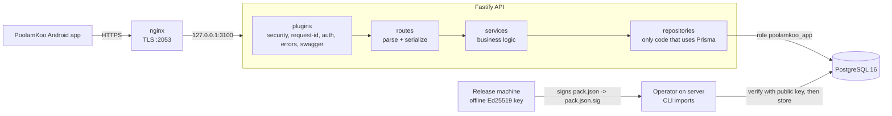

# PoolamKoo Server

[](https://github.com/onyx133/poolamkoo-server/actions/workflows/ci.yml)
[](LICENSE)
[](.nvmrc)

PoolamKoo (پولم‌کو) is a Persian-first, offline-first personal-finance Android app that reads bank SMS on the device and never uploads them. This server is the small optional companion: it publishes a richer category and merchant catalog, signed SMS rule-pack updates, and opt-in offers matched to a coarse income band. There are no accounts. The server cannot see messages, transactions or amounts, and the app works fully without it. Android app: [onyx133/PoolamKoo](https://github.com/onyx133/PoolamKoo).

## Features

- **Anonymous installs.** The app sends a random UUID; the server stores only `HMAC-SHA256(id, pepper)` and issues a 30-day JWT.
- **Catalog.** Categories, merchants and duotone vector icons, served from precomputed release snapshots with `ETag` and `304`.
- **Signed rule packs.** SMS parsing rules shipped as exact bytes with a detached Ed25519 signature; signed offline, verified by the app and at import.
- **Opt-in profile and offers.** A single income band plus period, revocable, used only to select offers. No impression tracking.
- **Erase.** One call deletes everything tied to an install.
- **Operator CLIs, no admin API.** Content is published from the command line on the server.
- **Privacy by construction.** No IPs, bodies or auth headers in logs; strict request schemas reject unexpected fields.
- RFC 9457 error responses, OpenAPI docs generated from the code, per-IP and per-install rate limits.

## Architecture



### Request lifecycle

```
client -> nginx (TLS, body <= 32k, overwrites X-Forwarded-For, passes X-Request-Id)
       -> request-id hook (honour valid id, else UUID)
       -> rate limit (per IP, or per install for authenticated routes)
       -> body parse (JSON only, <= 16 KiB) + Zod validation (strict objects)
       -> auth preHandler (JWT verify -> install row exists)      [authenticated routes]
       -> route -> service -> repository -> PostgreSQL
       -> Zod response serialization -> compression (br/gzip > 1 KiB) -> reply
errors at any step -> single error handler -> application/problem+json with request_id
```

## Endpoints

Full details are in [docs/api/contract-v1.md](docs/api/contract-v1.md). Live OpenAPI/Swagger UI: <https://<api-host>:2053/docs>.

| Method and path                          | Auth | Purpose                                                                         |
| ---------------------------------------- | ---- | ------------------------------------------------------------------------------- |
| `GET /v1/health`                         | no   | Liveness and version                                                            |
| `POST /v1/installs`                      | no   | Register or re-register an install, returns a token (`201` new, `200` existing) |
| `DELETE /v1/installs/me`                 | yes  | Erase everything stored for the install                                         |
| `PUT /v1/installs/me/profile`            | yes  | Set the opt-in income band, period and consent version                          |
| `DELETE /v1/installs/me/profile`         | yes  | Withdraw the opt-in                                                             |
| `GET /v1/profile/bands`                  | no   | Current income band table (`ETag`)                                              |
| `GET /v1/offers`                         | yes  | Offers for the install's band                                                   |
| `GET /v1/catalog`                        | no   | Catalog release (`ETag`, `304`)                                                 |
| `GET /v1/rule-packs/latest?app_version=` | no   | Newest signed rule pack the app version supports                                |

## Tech stack

| Choice                                                        | Why                                                                                                                         |
| ------------------------------------------------------------- | --------------------------------------------------------------------------------------------------------------------------- |
| Node.js 24 LTS, TypeScript (strict)                           | One language end to end, small footprint; `engines` allows Node 22+                                                         |
| Fastify 5 + Zod 4 type provider                               | Validation, types and OpenAPI from one schema ([ADR 0001](docs/adr/0001-fastify-zod.md))                                    |
| PostgreSQL 16 + Prisma 7                                      | Relational integrity, transactional imports, reviewable SQL migrations ([ADR 0002](docs/adr/0002-prisma-postgresql.md))     |
| `@fastify/jwt` (HS256)                                        | Stateless tokens with a DB existence check for instant revocation ([ADR 0003](docs/adr/0003-anonymous-installs-and-jwt.md)) |
| Node `crypto` (HMAC-SHA256, Ed25519)                          | No extra crypto dependency; offline-signed rule packs ([ADR 0004](docs/adr/0004-ed25519-rule-pack-signatures.md))           |
| `@fastify/helmet`, `@fastify/rate-limit`, `@fastify/compress` | Standard hardening, in-memory limits ([ADR 0007](docs/adr/0007-in-memory-rate-limits-and-caches.md)), br/gzip               |
| pino                                                          | Structured logs with field whitelisting and redaction                                                                       |
| Vitest + `embedded-postgres`                                  | Real Postgres in tests without Docker ([ADR 0010](docs/adr/0010-testing-strategy.md))                                       |
| ESLint, Prettier, GitHub Actions, Dependabot                  | Lint, format, typecheck, audit, Docker build on every PR                                                                    |
| Docker (multi-stage), nginx                                   | Non-root, read-only runtime image behind the host's reverse proxy ([ADR 0009](docs/adr/0009-shared-vps-deployment.md))      |

## Project layout

```
src/
  server.ts          entry: config -> prisma -> container -> app -> listen, graceful shutdown
  app.ts             buildApp(container, config): registers plugins and modules
  config.ts          zod-validated environment, fails fast
  container.ts       wires repositories into services
  lib/               problem details, crypto helpers, logging, prisma client factory
  plugins/           security, request-id, auth, error handler, swagger
  modules/<name>/    routes, service, repository, schemas
                     (health, installs, profile, offers, catalog, rule-packs)
  cli/               operator commands
prisma/              schema, SQL migrations, seed
seed/                bands.json, catalog seed, example offers
test/                unit/, integration/, helpers/
deploy/              production compose, nginx config, db role init, runbook
docs/                design, API contract, privacy, threat model, ADRs
```

Rules: routes only parse and serialise; services hold logic and depend on repository interfaces; repositories are the only code that touches Prisma. See [docs/design.md](docs/design.md).

## Run locally

Requires Node.js 22 or newer (see `.nvmrc`).

```sh
npm ci
cp .env.example .env            # set SERVER_PEPPER and JWT_SECRET: openssl rand -base64 48
npm run db:generate             # Prisma client, written to src/generated (gitignored)
```

With your own PostgreSQL (create the database and a role, put the URL in `.env`):

```sh
npm run db:migrate && npm run db:seed
npm run dev                     # http://localhost:3000, docs at /docs
```

With Docker Compose (Postgres, one-shot migrations, API as the least-privilege role):

```sh
docker compose up --build       # API on http://127.0.0.1:3000
```

`docker-compose.yml` uses development-only passwords and secrets.

## Configuration

Validated at start-up by `src/config.ts`; the process exits with a readable list of problems if anything is invalid. `.env.example` is the template.

| Variable              | Default                | Description                                                            |
| --------------------- | ---------------------- | ---------------------------------------------------------------------- |
| `NODE_ENV`            | `development`          | `development`, `test` or `production`                                  |
| `HOST`                | `0.0.0.0`              | Listen address                                                         |
| `PORT`                | `3000`                 | Listen port                                                            |
| `LOG_LEVEL`           | `info`                 | `fatal` to `trace`, or `silent`                                        |
| `DATABASE_URL`        | required               | PostgreSQL URL (the API should use the DML-only role)                  |
| `SERVER_PEPPER`       | required               | >= 32 bytes, base64 or hex; key for install-id HMAC                    |
| `JWT_SECRET`          | required               | >= 32 bytes, base64 or hex; signs access tokens                        |
| `JWT_TTL_DAYS`        | `30`                   | Access token lifetime, 1 to 365                                        |
| `TRUST_PROXY`         | `false`                | `false`, `true`, a hop count (e.g. `1`) or a comma-separated CIDR list |
| `RULEPACK_PUBLIC_KEY` | unset                  | Base64 raw 32-byte Ed25519 public key, used to verify packs on import  |
| `RATE_LIMIT_MAX`      | `120`                  | Requests per IP per minute                                             |
| `DOCS_ENABLED`        | `true`                 | Serve Swagger UI at `/docs`                                            |
| `APP_VERSION`         | `package.json` version | Reported by `/v1/health` and the OpenAPI document                      |

## Tests

```sh
npm test                    # everything
npm run test:unit           # services with fake repositories, helpers
npm run test:integration    # app.inject() against real PostgreSQL
npm run lint && npm run format:check && npm run typecheck
```

Integration tests need no setup: when `TEST_DATABASE_URL` is unset they start a throwaway PostgreSQL 16 through `embedded-postgres`; CI sets it to a service container. The suite covers the privacy invariants (no raw install id stored, no IPs or bodies in logs, erase removes everything).

## Operator CLIs

There is no admin HTTP API. Build first (`npm run build`); in production they run in the API image (`node dist/cli/<name>.js`).

| Command                                                          | Purpose                                                                           |
| ---------------------------------------------------------------- | --------------------------------------------------------------------------------- |
| `npm run catalog:import -- catalog-seed.json [--allow-removals]` | Validate the catalog (referential integrity), upsert, write a new release         |
| `npm run rulepack:keygen`                                        | Generate an Ed25519 key pair; private PEM outside the repo, prints the public key |
| `npm run rulepack:sign -- pack.json --key private.pem`           | Write `pack.json.sig`. Run on the release machine only                            |
| `npm run rulepack:import -- pack.json pack.json.sig`             | Verify against `RULEPACK_PUBLIC_KEY`, require a higher version, store verbatim    |
| `npm run offers:import -- offers.json`                           | Replace the offer set in one transaction                                          |

Production usage is in the [runbook](deploy/RUNBOOK.md).

## Deployment

Production runs on a shared VPS: Docker in safe mode (host networking, loopback binds), behind the host's nginx on HTTPS port 2053 with a Let's Encrypt certificate. Files are in [`deploy/`](deploy): `docker-compose.prod.yml`, `nginx/`, `.env.prod.example`, and [RUNBOOK.md](deploy/RUNBOOK.md) (first deploy, updates, imports, backups, secret rotation, troubleshooting). Rationale: [ADR 0009](docs/adr/0009-shared-vps-deployment.md).

## Security and privacy model

The server stores a keyed hash of a random install id, the platform, app version and store, a last-seen date, and, only with explicit opt-in, one coarse income band. It never receives SMS text, transactions, amounts or contact details, does not log IPs or bodies, and cannot sign rule packs: the signing key stays offline and the server only verifies. A full server compromise exposes little personal data and cannot push malicious parsing rules to the app.

- [docs/privacy.md](docs/privacy.md): data inventory, retention, erasure
- [docs/threat-model.md](docs/threat-model.md): assets, threats, mitigations, key rotation
- [SECURITY.md](SECURITY.md): reporting a vulnerability

## Architecture decisions

| ADR                                                       | Decision                                                     |
| --------------------------------------------------------- | ------------------------------------------------------------ |
| [0001](docs/adr/0001-fastify-zod.md)                      | Fastify with the Zod type provider                           |
| [0002](docs/adr/0002-prisma-postgresql.md)                | Prisma 7 and PostgreSQL                                      |
| [0003](docs/adr/0003-anonymous-installs-and-jwt.md)       | Anonymous installs: HMAC-SHA256 with a pepper, stateless JWT |
| [0004](docs/adr/0004-ed25519-rule-pack-signatures.md)     | Ed25519 detached signatures, offline signing                 |
| [0005](docs/adr/0005-operator-clis-no-admin-api.md)       | No admin HTTP API; operator CLIs                             |
| [0006](docs/adr/0006-catalog-release-snapshots.md)        | Catalog stored normalised, served from release snapshots     |
| [0007](docs/adr/0007-in-memory-rate-limits-and-caches.md) | In-memory rate limits and caches                             |
| [0008](docs/adr/0008-problem-details.md)                  | RFC 9457 problem details                                     |
| [0009](docs/adr/0009-shared-vps-deployment.md)            | Shared VPS deployment, Docker safe mode, port 2053           |
| [0010](docs/adr/0010-testing-strategy.md)                 | Testing strategy                                             |

## Contributing

See [CONTRIBUTING.md](CONTRIBUTING.md).

## License

[MIT](LICENSE) (c) 2026 onyx133
