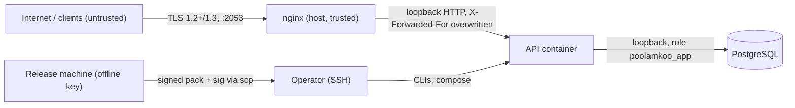

# Threat model

STRIDE-oriented analysis of the PoolamKoo server. Scope: the API, its database, the operator tooling and the deployment on the shared VPS. The Android app is a separate system; its trust in this server is limited to what is signed (rule packs) and what it verifies.

## Assets

| Asset | Why it matters |
|---|---|
| Rule-pack signing key (offline) | Anyone holding it can make apps accept arbitrary parsing rules. The most valuable secret |
| `SERVER_PEPPER` | Protects the install-id hashes against offline guessing |
| `JWT_SECRET` | Forging it would allow acting as any install whose hash is known |
| Database content | Install hashes, platform/version/store, last-seen date, opt-in income bands. Low sensitivity by design |
| Availability of catalog and rule packs | Convenience only; the app is offline-first |
| Integrity of served catalog, bands and offers | Wrong data would mislead users (offers are links shown in the app) |
| Operator access to the host | Gives control of the stack and the shared host's other services |

## Trust boundaries

1. Internet to nginx: everything is untrusted input.
2. nginx to API: loopback; the API trusts exactly one proxy hop for the client IP.
3. API to database: the API holds a DML-only role; it cannot alter schema.
4. Release machine to server: files only; trust comes from the signature, not the channel.
5. Server to app: the app trusts TLS for transport and the pinned public key for rule packs.

## Threats and mitigations

| # | STRIDE | Threat | Mitigations | Residual |
|---|---|---|---|---|
| 1 | Spoofing | **Access-token theft** (device compromise, traffic capture) | TLS only; 30-day expiry; token grants only the install's own tiny dataset; erase invalidates it immediately (existence check); HS256 pinned on sign and verify; `typ` and `sub` format validated | A stolen token works until expiry or erase; impact is writing/deleting that install's profile and reading its offers |
| 2 | Spoofing | **Install-id guessing / hijacking** | IDs are random UUID v4 (122 bits); the server stores only the keyed hash, so a leaked table gives no ids; the id is never returned by the API | Anyone who learns a raw id can register as that install; it is a device-held bearer secret |
| 3 | Information disclosure | **Enumeration** of installs or offers | No list or lookup endpoints; auth failures are uniform `401`; `POST /v1/installs` returns the same shape for new and existing (status code differs only for the caller's own id); per-IP limits (10/min on registration) | Status 200 vs 201 reveals whether an id was already registered, to someone who already has that id |
| 4 | Tampering | **Replay** of requests | State-changing calls are idempotent (upsert, delete, put of latest value); rule packs need strictly increasing versions and the app ignores older ones; TLS prevents on-path capture | Replaying an old valid rule pack to an app that has not yet updated is possible only for a pack that was legitimately signed |
| 5 | Denial of service | **Request floods, large bodies** | nginx `limit_req` (20 r/s per client, burst 40, `429`), `client_max_body_size 32k`, app body limit 16 KiB, header/body timeouts; global per-IP limit (IPv6 by /64) that also covers install-scoped routes, tighter limits on registration and per install; failed authentication counts against the limits and over-limit requests never reach the database; DB pool capped (`DB_POOL_MAX`, 3 s connect timeout); catalog and rule packs served from cache; 256 MB memory cap with `restart: unless-stopped` | Limits are in memory and per process; a distributed flood or a large botnet is not stopped. A Cloudflare/CDN front is the upgrade path |
| 6 | Denial of service | **Shared-NAT lockout** (many users on one IP) | Install-scoped routes are limited per install, not per IP; `RATE_LIMIT_MAX` is configurable | Anonymous endpoints can throttle users behind a busy carrier NAT |
| 7 | Tampering / Elevation | **Malicious rule pack** (bad parsing, abuse of the SMS pipeline) | Ed25519 detached signature verified in the app against a shipped key; server verifies at import; the private key is offline and not on the server; packs are stored and served as exact bytes; version must increase; app-side `minAppVersion` gating | See key compromise below |
| 8 | Elevation | **Server compromise** | Impact is bounded by design: no accounts, no PII beyond hashes, bands and dates; cannot forge rule packs (no private key); DB role is DML-only; container is read-only, runs as non-root, `cap_drop: ALL`, `no-new-privileges`, memory-limited, loopback only | An attacker could serve altered catalog data, offers or withhold updates, delete data, and read the low-sensitivity tables. Offers are only links shown in the app, so review offers before import |
| 9 | Elevation | **SQL injection** | Prisma parameterised queries; the few raw statements use tagged-template parameters; strict Zod schemas with `CHECK` constraints as a second layer | None known |
| 10 | Tampering | **Supply chain** (malicious dependency or base image) | Lockfile and `npm ci`; Dependabot weekly for npm, Actions and Docker; `npm audit --omit=dev --audit-level=high` gate in CI; few dependencies; multi-stage image with dev dependencies pruned from runtime; pinned major image tags | A compromised dependency still runs with the API's privileges, bounded as in row 8; tags are not pinned by digest |
| 11 | Information disclosure | **Database least privilege failure** | The API uses `poolamkoo_app` (SELECT/INSERT/UPDATE/DELETE, sequence usage). DDL is only run by `poolamkoo_owner`, a non-superuser, in the one-shot `migrate` container. Postgres is initialised with `--auth-host=scram-sha-256`, so every TCP connection, loopback included, needs a password; `trust` applies only to the unix socket inside the db container (reachable via `docker exec`, i.e. to whoever controls Docker, which is host root). The owner and superuser passwords are never given to the API container | With host networking the database port is open to every local process, which must still present a valid password. A local process that learns the app password can read and write the app tables (the API's own blast radius); the owner password allows DDL on this one database but not superuser actions |
| 12 | Information disclosure | **Transport interception** | TLS 1.2/1.3 only at nginx; HSTS; Let's Encrypt certificate; the app refuses cleartext; port 80 only redirects | No certificate pinning in app v1; a CA compromise or a hostile network CA could MITM. Rule packs remain protected by their signature |
| 13 | Information disclosure | **Secrets handling** | Secrets only in `deploy/.env` (mode 600, gitignored, never baked into images); `.env.example` has no values; `*.pem` gitignored; config fails fast on weak secrets; logs redact `authorization` and tokens; private signing key lives on the release machine | Secrets sit in plaintext on the host and in container environment; host root sees them |
| 14 | Information disclosure | **Log leakage** | No IPs, bodies or auth headers in app logs (tested); nginx `access_log off` | nginx error log (host-level) may contain IPs of failed requests |
| 15 | Repudiation | **No audit trail of operator actions** | CLI imports are versioned (catalog release rows, rule-pack versions); content files are kept in git | No per-action operator audit log; SSH logs on the host are the record |
| 16 | Tampering | **Clickjacking / XSS on `/docs`** | API responses carry a strict CSP (`default-src 'none'; frame-ancestors 'none'`); only the `/docs` routes use Swagger UI's own, hash-based policy; `DOCS_ENABLED=false` removes it (tested) | Swagger UI is third-party code on the API origin; the API sets no cookies, so impact is small |

## Rule-pack key compromise and rotation

Signing key compromise is the highest-impact event: an attacker with the key and any path to feed apps a pack (a hostile network, a compromised server or CDN) could make apps use hostile rules.

**Before an incident**

- Generate the key on the release machine, store the PEM outside the repository on encrypted storage, keep one offline backup.
- The app ships the public key; ship an app release that supports **two** trusted public keys (current and next) so rotation does not require every user to update at once.
- Keep `version` strictly increasing so a leaked old pack cannot roll apps back.

**On suspected compromise**

1. Stop publishing. Remove the compromised pack versions from the `rule_packs` table (as the owner) so the server cannot serve them.
2. Generate a new key pair on a clean machine (`rulepack:keygen`).
3. Release an app version that trusts the new public key and drops the old one. This is the step that actually revokes the old key; until users update, apps still trust it.
4. Replace `RULEPACK_PUBLIC_KEY` in `deploy/.env`, restart, and import a pack signed with the new key at a higher version.
5. Rotate `SERVER_PEPPER` and `JWT_SECRET` only if the server itself was compromised (see the runbook for the consequences).

**Routine rotation**: same procedure without steps 1 and 5, shipping the new key in an app release one release ahead of the switch.

## Residual risks

- Revoking a leaked signing key depends on app updates; there is no remote revocation channel by design (one would itself be an attack surface).
- Single host, single instance, no redundancy; availability depends on one VPS and one nginx shared with other tenants.
- In-memory rate limiting is defeated by distributed floods; the mitigation path is a CDN or proxy-level limiter.
- No certificate pinning; transport trust is the public CA system.
- Anyone with host root can read secrets and the database. The shared host's other tenants and administrators are within that trust boundary.
- Reachability: a foreign IP on a non-standard port may be filtered for some users; the app degrades to offline mode.
